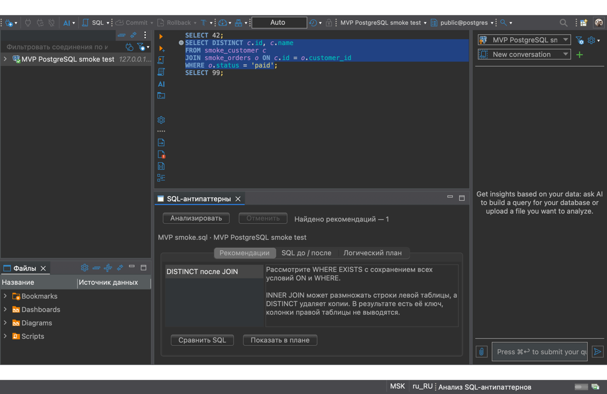
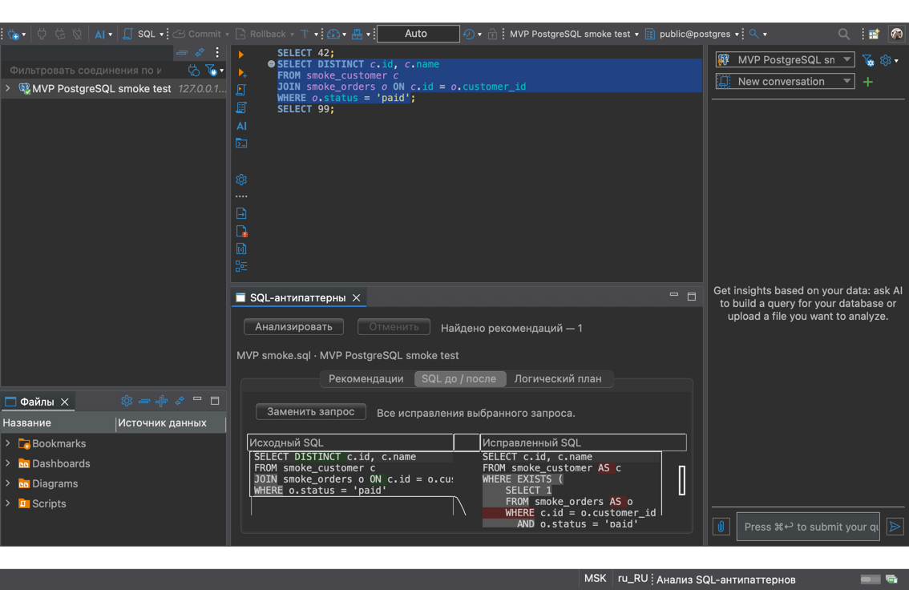
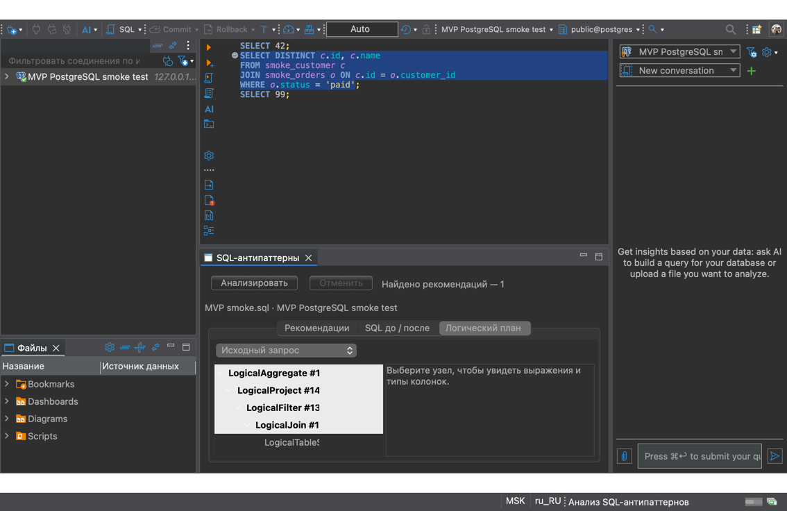

# Обнаружение SQL-антипаттернов на основе Apache Calcite

ВКР: разработка расширения для DBeaver, которое анализирует логический план SQL-запроса (`RelNode`), находит антипаттерны и предлагает исправления.

[Сайт проекта](https://antipatterns.vnshk.ru/)

[Исследование, источники и конспекты](research/)

## MVP DBeaver

Для PostgreSQL. Исправления с предпросмотром и Undo.

| Рекомендации | SQL до/после | Логический план |
| --- | --- | --- |
|  |  |  |

tbd
